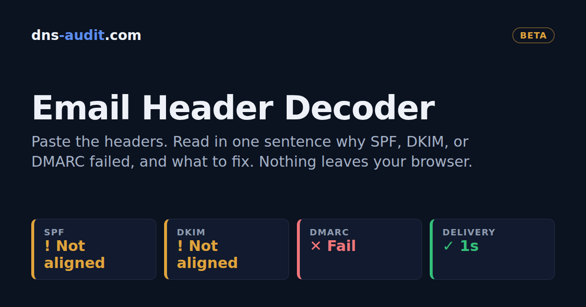

# Email Header Decoder (beta)

Paste the headers of any email and read, in one sentence, why it
passed or failed SPF, DKIM, and DMARC, and what to fix.

It takes bare headers, a whole .eml (paste it or drop the file on the
box; the body is ignored), or a copy of Gmail's Show original page.
Sample messages on the page show it working before you paste your own.

Live at https://headers.dns-audit.com, part of
[dns-audit.com](https://dns-audit.com).

## What it does that a header table doesn't

- **The finding comes first.** One sentence names the cause, then
  the fix follows as steps. A pass says there's nothing to fix.
- **One output, two depths.** The finding is in everyday words and
  names each term it uses. Technical details under it give the same
  finding in the protocol's own terms, with the raw lines it came
  from. Nobody has to pick a mode.
- **Two DMARC results.** The page shows the receiver's result and
  one it works out from the identifiers, with the reason when they
  disagree.
- **Forwards and mailing lists read correctly.** The ARC chain shows
  what passed before a forward, so a message the sender set up
  correctly isn't blamed on the sender.
- **Trust comes before parsing.** Authentication-Results fields a
  sender could have written are shown but never used. The hop
  timeline marks where the receiver took custody.
- **Filter headers are decoded** for Microsoft 365, Google,
  Proofpoint, Mimecast, Cisco, Barracuda, SpamAssassin, and Rspamd,
  with the raw value beside each one. Codes a vendor doesn't
  document are shown raw, with no meaning attached.
- **Look-alike From domains are flagged.** A From domain written in
  look-alike letters, such as mathematical bold or fullwidth
  characters, is called forged, since no registered domain can be
  spelled that way.
- **Evidence points at its source.** In Technical details, select a
  line reference and the raw header lines it came from light up.
- **It says what headers can't show** instead of guessing.
- **Copy report** gives a plain text summary for a ticket or a
  client email.

## Privacy

After each read the page sends dns-audit.com one usage note so its
maker can see the tool is used. The note holds the overall result
(pass, fail, and so on), whether a built-in sample was read, and the
host name of the site that linked to the page, if any. It holds no
header text, addresses, or domains from the paste. The
[privacy page](https://dns-audit.com/privacy) lists everything
dns-audit.com records with each note.

The light or dark theme you pick is saved in your browser's local
storage under the key `theme`, the same way dns-audit.com saves it.

## Limits

The page makes no DNS lookups and verifies no signatures. It reads
the results the receiving server recorded at delivery. The
organizational domain comes from a short built-in suffix list.
ARC seals are checked for structure, not verified.

It doesn't yet look up DKIM keys, decode bounces and SMTP codes, or
compare two messages. Shareable result links are left out on
purpose, because they would need a server.

## Beta

It's tested against synthetic headers built from the RFCs and
vendor documentation, and against a growing set of real messages.
It will still get some real mail wrong. If it reads one wrong, open
an issue with what it said and what it should have said. Please
describe the problem rather than attaching someone else's headers.

## Run it

Node 18 or later, no dependencies.

    node --test test/      run the tests
    node build.js          build dist/
    npm run sentences      rewrite docs/sentences.md

`dist/index.html` is the whole tool in one file and opens from
disk. The build also writes the files the static host needs
(`_headers`, `robots.txt`, `sitemap.xml`, and the share card).
[docs/sentences.md](docs/sentences.md) lists every sentence the
finding and the filter decode can show, by case. The header and
footer are the shared dns-audit.com site chrome, and
`test/chrome.test.js` checks them against the canonical lists. The
fixtures in `test/fixtures` are synthetic, and no real mail is
committed.

## Author

Built by [Neil Anuskiewicz](https://dns-audit.com/about), email
deliverability and DNS consultant.

## License

MIT
