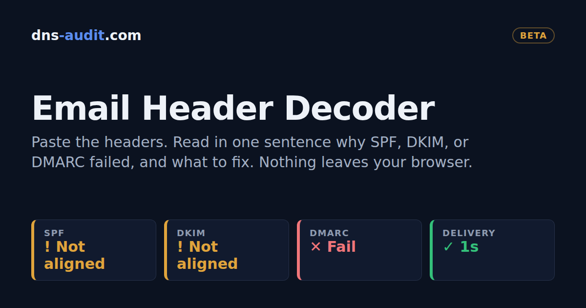

# Email Header Decoder (beta)

Paste the headers of any email and read, in one sentence, why it
passed or failed SPF, DKIM, and DMARC, and what to fix.

Live at https://headers.dns-audit.com, part of
[dns-audit.com](https://dns-audit.com).

## What it does that a header table doesn't

- **The finding comes first.** One sentence names the cause, then
  the fix follows as steps. A pass says there's nothing to fix.
- **Two voices.** Simple is written for a business owner. Technical
  uses the protocol's own terms for a deliverability practitioner.
- **Two DMARC results.** The page shows the receiver's result and
  one it works out from the identifiers, with the reason when they
  disagree.
- **Forwards and mailing lists read correctly.** The ARC chain shows
  what passed before a forward, so a message the sender set up
  correctly isn't blamed on the sender.
- **Trust comes before parsing.** Authentication-Results fields a
  sender could have written are shown but never used. The hop
  timeline marks where the receiver took custody.
- **Filter headers are decoded** for Microsoft 365, Google,
  Proofpoint, Mimecast, Cisco, Barracuda, SpamAssassin, and Rspamd,
  with the raw value beside each one.
- **Evidence points at its source.** In Technical, select a line
  reference and the raw header lines it came from light up.
- **It says what headers can't show** instead of guessing.
- **Copy report** gives a plain text summary for a ticket or a
  client email.

## Privacy

Everything runs in your browser. There is no server, no analytics,
and no storage, and the page makes no network requests. Its
Content Security Policy has no `connect-src`, so the browser blocks
requests the page makes. You can save the page and use it with
the network off.

## Limits

The page makes no DNS lookups and verifies no signatures. It reads
the results the receiving server recorded at delivery. The
organizational domain comes from a short built-in suffix list.
ARC seals are checked for structure, not verified.

It doesn't yet look up DKIM keys, decode bounces and SMTP codes, or
compare two messages. Shareable result links are left out on
purpose, because they would need a server.

## Beta

It's tested against synthetic headers built from the RFCs and
vendor documentation, and against a growing set of real messages.
It will still get some real mail wrong. If it reads one wrong, open
an issue with what it said and what it should have said. Please
describe the problem rather than attaching someone else's headers.

## Run it

Node 18 or later, no dependencies.

    node --test test/      run the tests
    node build.js          build dist/

`dist/index.html` is the whole tool in one file and opens from
disk. The fixtures in `test/fixtures` are synthetic, and no real
mail is committed.

## Author

Built by [Neil Anuskiewicz](https://dns-audit.com/about), email
deliverability and DNS consultant.

## License

MIT
